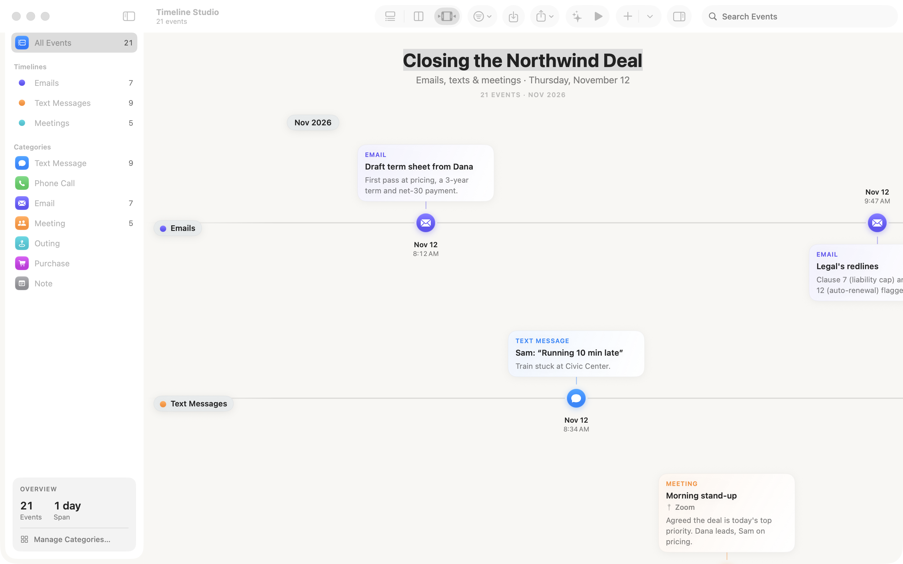
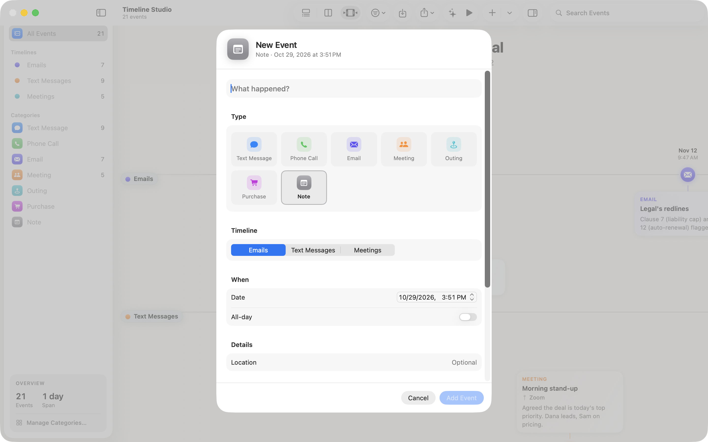
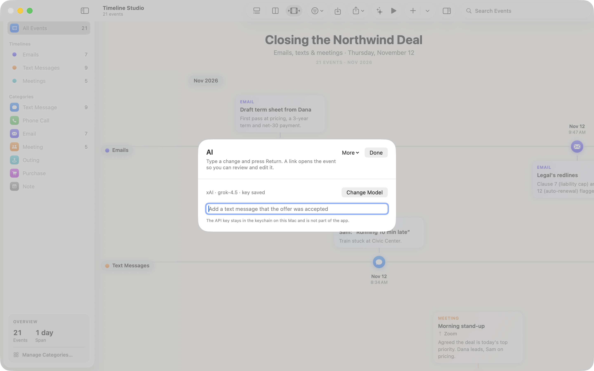
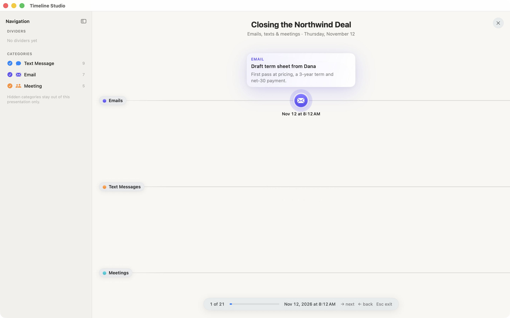

# Timeline Studio

Timeline Studio is a free Mac app from LegalAI. A lawyer builds the chronology on the Mac and presents it in the room. If you want help from a model, you can connect one you already use, at no charge from LegalAI. If you want LegalAI to run that same work, the price is $79 a month.

The chronology stays on the Mac. A linked document stays where it is. Checkout and the hosted model are not in this download. This disk image is ad-hoc signed and is not notarized.

Requires macOS 14 or later.

## Install

Download [Timeline Studio.dmg](dist/Timeline%20Studio.dmg) from this repository, or take the same file from the GitHub Release. The disk image contains one app for Apple silicon and Intel.

1. Open the disk image.
2. Drag **Timeline Studio** onto the Applications folder.
3. The first time you open it, macOS may say the developer cannot be verified. Control-click the app, choose **Open**, then choose **Open** again.

The API key for a model you connect is stored in the keychain on that Mac. It is not inside the app or this disk image.

## What a lawyer uses it for

The window holds one chronology. You can put up to three lanes on it at once: emails, calls, and meetings, or three people, or any three labels you type. Each card is one thing that happened, with a date, a type, notes, and an optional location.

- **Import a spreadsheet.** File → Import CSV… opens a preview. Every row is marked ready, warning, or skipped before anything is added. If the file has a `timeline` column, those values become the lane names.
- **Build it by hand.** File → New Event… sets the type, the lane, the date, and the location. Your own categories are under Timeline → Manage Categories…, and each one uses an icon from the library that ships with the app.
- **Point at the file.** Link a File… keeps a bookmark to a document, image, or recording on the Mac. A mark on the card opens that file while you present.
- **Mark the chapters.** A divider is a labelled line at a moment in the story, such as “Complaint served” or “Mediation.” In a presentation, each divider is its own step.
- **Present it.** The play button fills the screen with the title, then each step centers the next event. A sidebar lists the dividers and lets you hide a category for that presentation only. Escape leaves the presentation and returns to the chronology.
- **Hand someone a picture.** Export PDF or PNG of the chronology as it is currently shown.
- **Ask for a change in a sentence.** Timeline → AI… is one text field. Press Return. The change is applied, the sheet closes, and a confirmation at the top of the chronology names the event. That name is a link into the editor. Undo is in the Edit menu. The key stays in the keychain.
- **The same sheet has three more tools** under More: extract dated events from text you paste, review the chronology, and write a short memo. Those tools use the model you connected.

The pictures below are the sample chronology **Closing the Northwind Deal** (emails, texts, and meetings on one day). That file is `SampleData/three-timelines.csv`. A short fictional case, Henderson v. Acme Industries, is in `SampleData/henderson-v-acme.csv`.

### The chronology

Three lanes, the category list, and the cards for one day of a closing.



### An event

Type, lane, date, and location. Add Event stays off until the title is filled in.



### A sentence, then a link back to the event

Type the change and press Return. The confirmation that follows names the event and opens it.



### In the room

Step through the chronology. Categories can be hidden for this presentation only. Dividers, once you add them, are listed in the same sidebar.



## The $79 month

The canvas is free: import, lanes, icons, file links, presentation, and export.

Connecting your own model is also free. The request goes only to the provider you choose. LegalAI does not see it.

The $79 month is for the month when LegalAI runs those same tools, so a solo or small-firm lawyer does not have to connect a model. When that service is running, the month is also meant to include:

- A one-page letter for the client file. It says the documents are processed in the United States, are not used to train a model, and are deleted.
- One bill, with a stated allowance of pages and recorded hours. Work past that allowance is billed as overage. The numbers are on the bill.
- One chronology a month whose page cites have been checked. The review is capped. It is a checked chronology, and it is not an open-ended review of the whole file.
- A person who answers the phone before the hearing.
- The packet for that chronology: the memo, the exhibit timeline, and the contradiction list.
- Two Macs: the lawyer and one assistant.
- A current signed app, and a current model, without a settings change the morning of court.

This download does not take payment, and it does not contain the hosted model. The address for that model is empty. Google Cloud Assured Workloads and CJIS coverage are not part of this build. Advising, CLE, case-law research, and patterns across cases are not part of the month.

`AI_FEATURES.md` is an earlier sketch. It still describes a $20 tier, a notarized disk image, and Assured Workloads. Read the README for the offer above. The Subscription window inside the app still shows that earlier sketch. Pasting a license key there does not start a charge.

## Sample files

| File | What it is |
|---|---|
| `SampleData/three-timelines.csv` | Emails, text messages, and meetings on one day. |
| `SampleData/henderson-v-acme.csv` | Fictional Henderson v. Acme Industries: a demand, a site walk, a call, the complaint, the adjuster, and mediation. |
| `SampleData/sample-events.csv` | A small mixed chronology for trying the importer. |
| `SampleData/showcase/` | Public historical chronologies for a demonstration. |

CSV columns the importer expects: `date`, `description`, and `notes`. Optional columns include `type`, `time`, `location`, `amount`, and `timeline`. A preview appears before any row is added.

## Build it yourself

```bash
xcodebuild -project TimelineStudio.xcodeproj -scheme TimelineStudio -configuration Release -derivedDataPath build/DerivedData -destination 'platform=macOS' ARCHS='arm64 x86_64' ONLY_ACTIVE_ARCH=NO build
open "build/DerivedData/Build/Products/Release/Timeline Studio.app"
```

A Debug launch can read `XAI_API_KEY` from the environment, store that value in the keychain, and then forget it. The Release build used for the disk image does not contain that loader. Keep keys out of the project, the disk image, and git.

The checks run on the app before this disk image was built are in [docs/TESTS.md](docs/TESTS.md).

## Layout

```
TimelineStudio/
  App/        App entry, menus, and the debug snapshot harness
  Models/     Events, categories, lanes, and the plan types
  Services/   Import, export, attachments, and the model client
  Views/      Chronology, editor, presentation, and the AI sheet
SampleData/   Chronologies you can import
site/         The short page that describes the same offer
dist/         The disk image
```

A marketing page that matches this offer is in `site/`. Open `site/index.html` in a browser.
